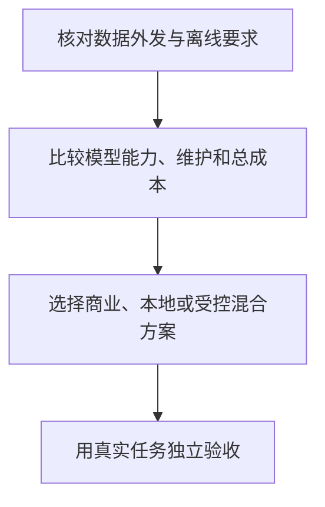

# 模型接入与部署

选择 AI 接入方式时，先看任务约束，再看模型品牌。商业服务、本地部署和混合方案各自解决不同问题。本页只负责选路；实际操作分别进入商业服务、本地部署与中转站的专题。

## 先判断你的首要约束

1. **数据能否上传**：涉及客户数据、源码、合同或个人隐私时，先确认服务条款、数据保留和组织政策。
2. **是否必须离线**：断网可用、内网访问或固定环境是硬约束时，本地部署的优先级更高。
3. **能承担多少维护**：商业服务可以减少模型部署和基础设施维护，用户仍需处理限流、服务中断、调用失败和回退；本地路线还需要自己处理硬件、模型格式、性能和安全更新。
4. **结果如何验证**：无论模型运行在哪里，事实、代码和高风险操作都需要独立验收。

## 选择商业服务

商业服务适合希望快速获得模型能力、多模态功能和产品界面，且愿意接受网络、账号、配额与数据条款约束的场景。

先用真实任务试用，再决定订阅、API 或团队方案。选型方法见[使用商业 AI](./使用商业AI.md)。

## 选择本地部署

本地部署适合必须离线运行、需要将原始数据留在自有环境、想实验开源模型，或需要控制推理版本与部署节奏的场景。

硬件内存只是起点，模型量化、上下文长度、并发量、首字延迟和输出速度都会影响是否可用。具体选型见[本地部署 AI](./本地部署AI.md)。

## 能力主权不是一定自建模型，而是保持可迁移

模型服务本身也是工作系统的外部依赖。版本升级、配额、价格、访问政策、数据保留条款、API 形态或账号状态发生变化，都可能让一套原本有效的工作流突然退化。对长期依赖 AI 的团队，更重要的问题不是“模型是不是自己部署”，而是**核心能力能否在供应商变化时迁移和重建**。

可以把这种能力主权拆成六个尽量由自己掌握的部分：

- **Context**：业务资料、代码索引、历史案例和知识库能够独立保存与重建。
- **Skill**：工作方法、Prompt、规则和流程不只存在于某个厂商的私有产品配置中。
- **Eval**：有自己的真实任务集和验收标准，换模型后能知道能力究竟提升还是下降。
- **Harness**：编排、状态、工具、预算和权限控制不与单一模型强绑定。
- **Trace**：保留必要的输入版本、工具调用、结果和验证证据，能够复现关键任务。
- **Interface**：通过可替换的模型适配层隔离供应商 API 差异，而不是让业务逻辑直接依赖某一家特有接口。

因此 **AI Capability Sovereignty ≠ Self-host Everything**。商业前沿模型可能仍然是某些任务的最佳选择，本地模型也可能在数据控制、离线和版本稳定上更合适。目标是让模型成为可替换组件：Claude、GPT、GLM 或本地模型发生变化时，组织自己的 Context、Skill、Eval、Harness 和 Trace 仍然存在，并能用同一组任务重新验证。

自托管是提高控制力的一种方式，但同时把模型更新、推理基础设施、容量和安全维护责任转移给自己。是否值得，应由数据边界、连续性要求、能力差距和总成本决定，而不是把“本地”本身当成主权目标。

## 组合两条路线

混合方案可以按数据和任务分流：敏感资料可先在本地检索、脱敏或摘要，但本地处理本身不会改变数据密级。只有经过明确规则或人工审查、已确认允许外发的内容，才可以交给商业模型。日常任务也可以使用本地小模型，困难且可上传的任务再调用外部模型。

这类分流需要明确的数据分类、日志边界和失败回退策略。统一多个 API 时，阅读 [AI 中转站](/ai-relay)；需要理解具体实现时，阅读 [Sub2API](/sub2api)。数据使用边界引用 [AI 隐私与机密保护](/ai-privacy-confidentiality)，不因模型部署在本地就省略授权检查。
