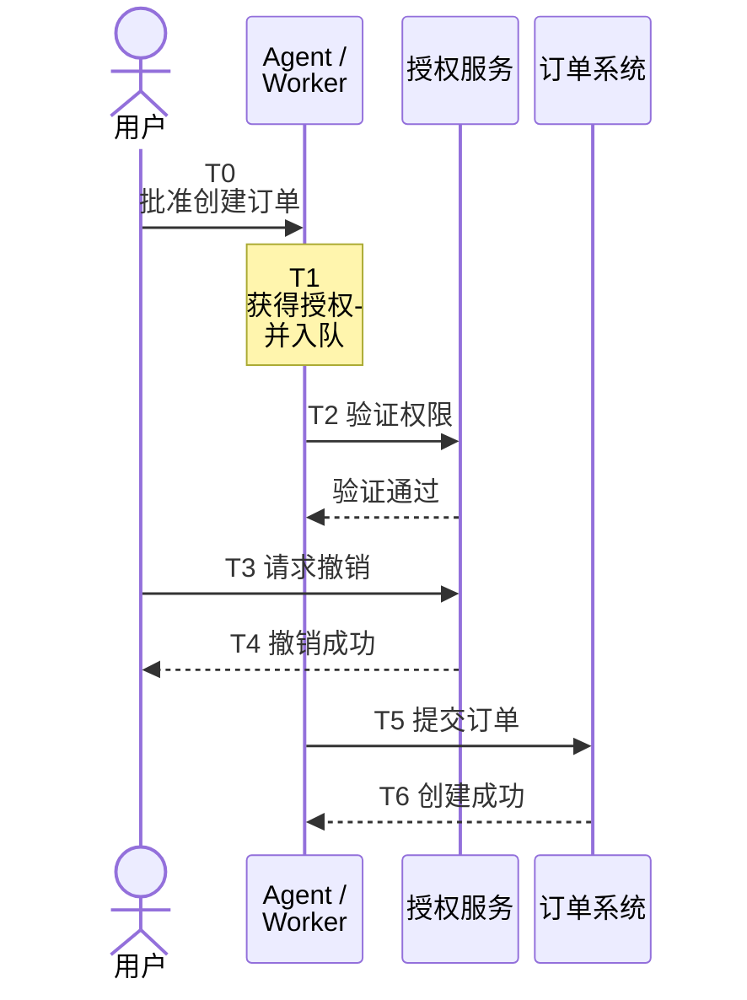

# Agent 权限撤销的最后一公里：为什么撤销成功后，业务操作仍可能继续执行？

企业开始让 AI Agent 执行采购、退款、代码发布和基础设施变更。与传统应用不同，这些任务可能持续数分钟甚至数小时，期间经历多次模型推理、工具调用、人工审批和异步队列调度。

这带来了一个容易被忽略的安全问题：**用户撤销 Agent 的权限时，已经获得批准、但尚未完成的操作应该如何处理？**

假设用户授权 Agent 创建一笔采购订单。Agent 完成审批，将订单提交到异步队列。用户随后发现供应商信息有误，立即撤销授权。系统返回“撤销成功”，但几秒钟后，队列中的 Worker 仍然使用此前签发的凭证创建了订单。

这种情况不一定涉及 Prompt Injection、凭证泄露或模型越权。即使 Agent 严格遵守指令，OAuth Token 的验证和工具网关的权限检查也完全按照设计运行，业务副作用仍可能发生。

根本原因在于：**身份凭证失效、操作授权失效和业务操作停止，是三个不同的安全事件。**

只有明确它们各自的生效边界，才能真正设计出可验证的 Agent 权限撤销机制。

## 撤销 Token 不等于停止已经开始的任务

2026 年 10 月 27 日，IBM 发布面向企业 Agent 的身份与凭证控制能力，强调独立 Agent 身份、短期凭证以及实时撤销。类似机制正在成为企业 Agent 安全架构的重要组成部分，但厂商公告并未给出跨异步队列和业务系统的端到端撤销一致性实验。([IBM 官方公告](https://newsroom.ibm.com/2026-10-27-ibm-introduces-identity-and-control-for-ai-agents%2C-securing-frontier-intelligence-for-the-enterprise))

从 OAuth 标准本身看，Token Revocation 也没有承诺停止所有已经启动的业务操作。

RFC 7009 定义了撤销 OAuth Access Token 和 Refresh Token 的接口。标准要求授权服务器使被撤销的令牌失效，但同时明确指出，撤销状态在不同服务器之间可能存在传播延迟。Refresh Token 被撤销，也不必然意味着所有关联 Access Token 都立即无法使用，具体取决于授权服务器的实现与撤销策略。([RFC 7009](https://www.rfc-editor.org/rfc/rfc7009.html))

RFC 7662 进一步定义了 Token Introspection。资源服务器可以通过该接口查询令牌是否有效，但规范也说明，缓存 Introspection 结果可能导致已经被撤销的 Token 在缓存有效期内继续获得授权。([RFC 7662](https://datatracker.ietf.org/doc/html/rfc7662))

即使完全解决上述问题，仍然存在另一类竞态。

考虑以下示例时间线：



这里的关键不是 T5 时 Token 是否仍然有效，而是 Worker 在 T2 已经完成权限检查，并将此前的检查结果用于后续执行。

从 T2 到 T5，授权状态可能发生变化，但业务系统不知道。

这就是授权检查与业务执行之间的 TOCTOU（Time-of-Check to Time-of-Use）问题。

对于只读操作，短暂的权限状态不一致可能主要影响数据访问；对于资金、权限和生产变更操作，一次已经完成的副作用则可能无法简单撤销。

## 强一致的权限检查，为什么仍然不够？

解决这一问题的直觉是：不要缓存授权结果，每次执行都查询最新权限。

这确实是必要改进，但它仍然没有自动解决操作提交时的竞态。

以细粒度授权系统 SpiceDB 为例，其官方文档提供不同的一致性模式。`minimize_latency` 优先利用缓存，允许一定程度的数据陈旧；`at_least_as_fresh` 可以结合 ZedToken，要求权限查询至少看到某个已知版本的授权状态；`fully_consistent` 则尝试使用当前最新的数据快照。([SpiceDB 一致性文档](https://authzed.com/docs/spicedb/concepts/consistency))

这里有两个重要细节。

首先，**权限检查使用最新快照，不代表业务操作提交时权限仍然有效。**

假设 Worker 在 10:00:00.000 完成一次完全一致的权限检查，用户在 10:00:00.010 撤销授权，Worker 在 10:00:00.100 才提交订单。

即使第一次检查完全正确，仍然可能发生撤销之后的业务提交。

其次，所谓完全一致，也需要结合具体底层存储理解。

Authzed 的多区域部署文档明确说明：在使用 CockroachDB 的特定部署条件下，SpiceDB 的 `fully_consistent` 不能保证跨节点的 Read-After-Write 一致性，因为不同节点获取的逻辑时间戳可能存在偏差。官方建议使用写操作返回的 ZedToken，并在后续查询中指定 `at_least_as_fresh`，以保证查询看到至少与该写操作一样新的授权状态。([Authzed 多区域部署文档](https://authzed.com/docs/authzed/concepts/multi-region))

这不是说 SpiceDB 普遍存在授权绕过漏洞，而是提醒我们区分两种不同的保证：

**授权状态的新鲜度**，回答检查时看到的是哪个版本的权限。

**授权与副作用的一致性**，回答实际提交操作时，之前的权限判断是否仍然成立。

ZedToken 能帮助解决前一个问题，却不会自动把另一个数据库中的订单提交与授权检查合并为一个原子事务。

## 把撤销检查放到业务提交点

要获得更强的撤销保证，需要把安全边界继续向真实业务资源移动。

对于企业内部可控的业务系统，可以引入一种资源侧撤销栅栏（Revocation Fence）设计。

这一设计并不是新的 OAuth 标准，而是将已有的授权版本控制、事务隔离和资源侧强制执行组合起来。

每次 Agent 获得执行权限时，授权服务记录一个明确的授权版本，例如：

```json
{
  "grant_id": "grant-123",
  "epoch": 7,
  "agent_id": "agent-456",
  "resource": "purchase-order-789",
  "action": "create_order",
  "arguments_digest": "sha256:...",
  "expires_at": "..."
}
```

其中，`epoch` 表示授权版本，`arguments_digest` 绑定已经批准的具体业务参数。

当 Agent 提交订单时，业务资源侧不能仅仅信任此前由网关返回的 Allow，也不能只相信 Worker 持有的 Token。

它需要确认当前授权是否有效、授权版本是否仍然一致、业务对象是否仍然属于正确的用户，以及即将提交的参数是否与批准时一致。

更重要的是，**授权检查和业务提交必须处于同一个可序列化的边界内，或者具备等效的原子提交约束。**

在授权状态与业务对象位于同一 PostgreSQL 数据库的场景中，可以考虑使用事务和行锁建立顺序关系。

例如，提交订单的事务先锁定相应授权记录，检查 `epoch`、撤销状态和业务参数，再写入订单及唯一操作标识。撤销事务也必须锁定同一授权记录，更新其状态与版本。

PostgreSQL 的 `SELECT ... FOR UPDATE` 可以阻止其他事务在当前事务结束前修改或锁定相同的记录，为这种顺序约束提供基础。([PostgreSQL 行级锁文档](https://www.postgresql.org/docs/18/explicit-locking.html#LOCKING-ROWS))

于是，两种并发情况可以得到明确结果。

如果撤销事务先完成，之后获得锁的订单事务会看到授权已经失效，拒绝创建订单。

如果订单事务先完成，那么撤销事务必须等待。此时订单已经在撤销生效前提交，系统不能将其错误地描述为撤销后的越权操作。

这建立了一个更明确的安全不变量：

**在同一可控事务域内，强撤销确认完成之后，旧授权版本不得再提交新的业务副作用。**

但这里有一个必须满足的前提：授权状态检查与业务提交真正共享可靠的事务序列化机制。

如果授权状态位于独立的权限服务中，订单位于另一个数据库，简单地先调用一次授权 API，再提交订单，并不会因为增加了 `epoch` 字段就获得原子性。

## 异步队列和第三方系统，是撤销语义最困难的边界

上述设计适用于能够控制业务提交事务的场景。

现实中的 Agent 任务经常跨越多个系统：

```text
Agent
  ↓
MCP Tool Gateway
  ↓
授权服务
  ↓
异步任务队列
  ↓
Worker
  ↓
内部订单系统
  ↓
第三方供应商或支付系统
```

问题在于，内部订单系统提交成功，不一定意味着外部业务副作用已经完成。

例如，订单服务在本地事务中写入一条 Outbox 事件，随后由另一个 Worker 将它发送给外部供应商。

假设订单事件在撤销前已经提交，但外部请求在撤销后才真正发出。

此时，仅对本地订单事务建立撤销栅栏，不能保证外部供应商不会收到新的操作。

一种改进方式，是让 Outbox Worker 在执行前再次检查授权版本。但这仍然存在检查之后、发送之前的竞态。如果外部系统已经接收请求却尚未返回结果，本地服务甚至无法确定该副作用是否已经发生。

因此，跨系统撤销不能简单承诺“调用一个撤销接口，所有操作立即停止”。

更合理的设计是明确区分两种撤销确认。

**撤销请求已受理（Revocation Received）**：系统已经记录停止意图，禁止创建新的授权，并开始阻断队列任务和相关执行路径。这不代表所有已经启动的动作都停止。

**撤销已生效（Revocation Effective）**：系统能够证明，在其明确承诺覆盖的资源边界内，旧授权不会再产生新的业务提交。

如果涉及无法确认状态的第三方系统，系统就不能对整个执行链返回具有强语义的撤销完成确认。

对于已经发出但结果未知的请求，应当保留明确的 `UNKNOWN` 或 `IN_FLIGHT` 状态，继续进行状态查询、对账或人工处理，而不是把网络超时解释为操作失败。

如果第三方系统支持请求幂等键、取消接口或可确认的停止机制，可以进一步降低重复执行和残余副作用风险。但幂等性只解决重复执行的一部分问题，不等于授权撤销；补偿也不等于原操作从未发生。

真正无法撤销的操作，例如已经生效的资金划转、已经发送的外部通知或者已经发布的生产变更，只能通过预先限制权限、延迟高风险提交、设置人工确认窗口或设计补偿机制来降低后果。

这也意味着，不同业务动作应该有不同的撤销服务等级，而不能共享一句含糊的“实时撤销”。

## 三种架构的安全收益与成本

从企业落地角度，可以将撤销架构分为三个层次。

| 架构 | 主要控制 | 能够解决的问题 | 仍然存在的风险 |
|---|---|---|---|
| A：身份与凭证撤销 | 短期 Token、Token Revocation、凭证轮换 | 减少旧凭证继续获得访问的机会 | 已完成授权检查的任务仍可能提交 |
| B：持续授权校验 | A + 授权版本、Read-After-Write 一致性、逐次权限检查 | 减少授权缓存和旧版本导致的越权 | 权限检查与业务提交之间仍可能竞态 |
| C：资源侧撤销栅栏 | B + 提交点原子检查、操作账本、可确认停止协议 | 在可控事务域内建立撤销与业务提交的明确顺序 | 跨服务协调复杂，第三方不可撤销操作仍有残余风险 |

从安全强度看，C 提供了更明确的提交约束，但不能由此推断它在任何系统中都优于 B。

它可能增加数据库锁竞争、权限查询延迟、队列积压和故障期间的任务拒绝率。对于大量低风险只读操作，这些成本未必合理。

因此，架构选择应该取决于动作的真实后果，而不是 Agent 是否使用了某种特定模型或框架。

只读取公开资料的 Agent，可以接受较轻的授权一致性要求。能够修改生产权限、提交支付指令、改变用户权益或执行批量操作的 Agent，则需要更严格的资源侧提交控制。

对于跨区域、跨数据库的高影响操作，还需要根据业务可接受的延迟和可用性，决定采用同步确认、单资源事务栅栏、异步补偿，还是将部分操作保留为人工执行。

## 如何验证撤销机制真正有效

验证不能停留在检查撤销 API 是否返回成功，也不能只确认网关拒绝了新的 Tool Call。

真正需要检查的是，在不同并发顺序下，业务系统最终产生了什么效果。

可以在完全隔离、使用虚构订单和凭证的环境中构建授权服务、任务队列、Worker、业务数据库和效果账本，对 A、B、C 三种架构进行相同条件的测试。

测试重点不是构造复杂的 Prompt Injection，而是控制授权撤销与动作提交的先后关系。

例如，在 Worker 完成权限检查后暂停执行，随后撤销授权并取得相应确认，再恢复 Worker，观察订单是否提交。

其他必要场景包括授权撤销期间的队列重试、重复消息、Worker 重启、权限缓存过期、资源版本变化、授权服务网络分区，以及第三方系统已接收请求但本地调用超时。

每次测试都需要同时记录正常任务完成率、错误拒绝率、撤销确认延迟、业务提交延迟、重复副作用和结果未知的请求数量。

其中最重要的安全指标不是“撤销 API 成功率”，而是：

**在明确的强撤销确认之后，仍然产生的新业务副作用数量。**

分母应当是实际覆盖该撤销边界、并在确认后尝试执行的受限动作数量，而不是所有 Agent 请求。

如果为了阻止撤销后的操作，系统把所有正常任务都拒绝，安全指标可能看起来很好，业务却无法运行。因此还必须同时报告正常任务的完成情况及性能代价。

本次研究依据 OAuth 标准、SpiceDB 官方一致性文档和 PostgreSQL 事务机制完善了上述架构推理。尚未部署真实授权服务或执行完整的并发对照实验，因此这些结论属于有明确技术依据的架构分析，而不是已经证明某套产品实现有效的实验结果。

## Agent 安全最终要回答的是：谁能停止真实业务副作用？

企业正在为 AI Agent 建立独立身份、最小权限、短期凭证、工具网关和统一审计。这些能力解决了过去服务账号长期共享、凭证暴露和授权缺乏治理的问题。

但如果 Agent 已经把操作交给了队列、Worker 或第三方系统，身份平台就不一定掌握实际业务执行的最后决定权。

这意味着，Agent 安全架构还需要在身份治理之外，明确每一种高影响业务动作的最终提交点、撤销生效条件和剩余风险。

对于完全可控的内部资源，可以通过授权版本、事务序列化和资源侧强制执行建立可验证的撤销边界。对于不可控的外部系统，则必须明确哪些动作可以停止、哪些已经不可逆转，以及什么时候只能报告状态未知。

**能够撤销 Agent 的凭证，是身份安全能力；能够证明旧授权不再产生新的业务副作用，才是执行安全能力。**

二者之间的差距，正是企业将 Agent 从辅助决策系统升级为自主执行系统时，需要重点解决的架构问题。
