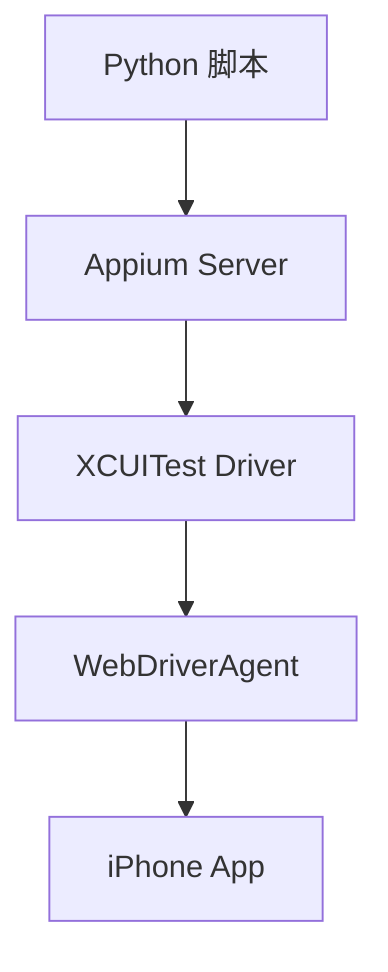

iOS 真机自动化的目标，是让一台未越狱 iPhone 成为可以被脚本稳定驱动的执行端。它能打开 App、点击按钮、读取页面树、截图、滚动页面，并把屏幕上合法可见的信息沉淀成结构化数据。

下面按可实际操作的顺序写。即使之前没有做过 iOS 自动化，也可以按步骤从环境准备、设备信任、WDA 签名、首次运行，一直走到支付宝资产采集和 Health Auto Export 服务器启动。

## 先看全链路

未越狱 iPhone 的控制链路是：



每一层负责一件事。

- Python 脚本：描述要打开哪个 App、点击哪里、保存什么数据。
- Appium Server：提供 WebDriver 接口，接收脚本命令。
- XCUITest Driver：把 Appium 命令交给 Apple 的 UI 测试框架。
- WebDriverAgent：安装到 iPhone 上，真正执行点击、滑动、截图、读取页面树。
- iPhone App：被控制的目标 App，例如支付宝、Safari、Health Auto Export。

这条链路的能力边界也要先确认。

- 可以控制屏幕上可见、可访问性树能暴露的 UI。
- 可以保存截图、XML 页面树、JSON 执行摘要。
- 可以等待用户完成登录、人脸、密码、安全校验。
- 不能读取其他 App 的私有数据库。
- 不能绕过系统权限、登录校验、支付密码和业务安全策略。

最终要做到的稳定状态是：Mac 能识别 iPhone，Xcode 能构建 WDA，钥匙串允许 `codesign` 使用开发证书，iPhone 信任开发者证书，Appium 能创建会话，脚本能根据页面状态继续执行。

## 第一步：准备 Mac

先进入项目目录。后面的命令默认都在这个目录运行：

```bash
cd ~/Projects/FEEI.CN
```

安装基础命令行工具：

```bash
brew install libimobiledevice ios-deploy
```

安装 Appium 和 XCUITest Driver：

```bash
npm install -g appium
appium driver install xcuitest
```

安装 Python 客户端：

```bash
python3 -m pip install Appium-Python-Client
```

确认使用完整 Xcode。WebDriverAgent 需要完整 Xcode，只有 Command Line Tools 不够：

```bash
xcodebuild -version
sudo xcode-select -s /Applications/Xcode.app/Contents/Developer
```

检查项目脚本需要的环境：

```bash
python3 scripts/ios_appium_capture.py --check
```

理想输出应该包含这些项目，并且状态是 `OK`：

```text
xcodebuild
idevice_id
ios-deploy
appium
Appium-Python-Client
```

如果 `--check` 末尾提示没有发现 iPhone，先继续做第二步，把 iPhone 连接和信任做好。

## 第二步：准备 iPhone

用数据线把 iPhone 连接到 Mac。手机上出现「信任这台电脑」时，点击「信任」，并输入锁屏密码。

打开 iPhone 的开发者模式。路径通常是：

```text
设置 -> 隐私与安全性 -> 开发者模式
```

打开后按系统提示重启 iPhone。重启后再次确认启用开发者模式。

保持 iPhone 解锁，屏幕不要熄灭。首次运行 WDA 时，手机上可能出现开发者证书信任提示；如果屏幕锁住，自动化链路会卡在等待状态。

回到 Mac，列出已连接设备：

```bash
python3 scripts/ios_appium_capture.py --list-devices
```

如果能看到一串 UDID，先记下来，后面命令会用到：

```text
00000000-0000000000000000
```

如果同时连接多台 iPhone，每次运行脚本都要传 `--udid`。这可以避免脚本控制错设备。

## 第三步：准备 Xcode 签名

WebDriverAgent 会作为测试 App 安装到 iPhone 上，所以它必须能被你的 Apple 账号签名。

先打开 Xcode，进入：

```text
Xcode -> Settings -> Accounts
```

添加 Apple ID。添加完成后，选中账号，确认下面有一个 Team。个人账号一般会显示 `Personal Team`。

记录这个 Team 的 `Team ID`。它通常是 10 位左右的大写字母和数字，例如：

```text
ABCDE12345
```

证书名称里括号中的字符串不一定是可用 Team ID。脚本里要填的是 Xcode Accounts 或 provisioning profile 里的 Team ID。

再准备一个 WDA bundle id。格式建议使用自己能控制的命名空间：

```text
com.yourname.WebDriverAgentRunner
```

例如：

```text
com.feei.WebDriverAgentRunner
```

后面命令里的两个值需要替换成自己的真实值：

```text
YOUR_TEAM_ID
com.yourname.WebDriverAgentRunner
```

首次验证 WDA 时，直接跑 Xcode 构建命令。把 `UDID`、`YOUR_TEAM_ID` 和 `com.yourname.WebDriverAgentRunner` 替换掉：

```bash title="首次构建并运行 WebDriverAgent" {4,7-8}
xcodebuild \
  -project ~/.appium/node_modules/appium-xcuitest-driver/node_modules/appium-webdriveragent/WebDriverAgent.xcodeproj \
  -scheme WebDriverAgentRunner \
  -destination id=UDID \
  -allowProvisioningUpdates \
  -allowProvisioningDeviceRegistration \
  DEVELOPMENT_TEAM=YOUR_TEAM_ID \
  PRODUCT_BUNDLE_IDENTIFIER=com.yourname.WebDriverAgentRunner \
  test
```

第一次执行可能会比较慢。Xcode 会尝试创建 profile、注册设备、安装 WDA。

<details>
<summary>WDA 签名异常：证书信任与钥匙串弹窗</summary>

如果 Xcode 报开发者证书未被信任，在 iPhone 上打开：

```text
设置 -> 通用 -> VPN 与设备管理
```

找到对应的 Developer App，点击信任。信任完成后，重新执行上面的 `xcodebuild` 命令。

如果屏幕上连续弹出 `codesign wants to access key`，说明钥匙串没有允许 `codesign` 自动访问 Apple Development 私钥。用下面命令处理一次：

```zsh
trap 'stty echo 2>/dev/null' EXIT
printf "login keychain password: "
stty -echo
read KEYCHAIN_PASSWORD
stty echo
printf "\n"

KC="$HOME/Library/Keychains/login.keychain-db"
security unlock-keychain -p "$KEYCHAIN_PASSWORD" "$KC"
security set-key-partition-list -S apple-tool:,apple:,codesign: -s -k "$KEYCHAIN_PASSWORD" "$KC"
security set-keychain-settings -lut 21600 "$KC"
unset KEYCHAIN_PASSWORD KC
trap - EXIT
```

这里输入的是 Mac 登录钥匙串密码，通常就是当前 Mac 用户的登录密码。命令执行成功后，再跑一次 WDA 构建。正常情况下，签名私钥弹窗会消失。

如果已经被一堆弹窗卡住，先停止当前构建进程：

```bash
pgrep -fl "xcodebuild|codesign|WebDriverAgent|XCTRunner|appium"
```

确认 PID 属于这次自动化任务后，再结束它：

```bash
kill -9 PID
```

处理完钥匙串授权后重新开始，不要在弹窗堆叠时继续反复运行脚本。

</details>

## 第四步：跑通一次基础控制

先启动 Appium。这个命令会占用当前终端窗口，保持它运行：

```bash
appium
```

看到类似下面的信息，说明 Appium Server 已经启动：

```text
Appium REST http interface listener started on http://0.0.0.0:4723
```

另开一个终端，进入项目目录：

```bash
cd ~/Projects/FEEI.CN
```

先用 Safari 做最小验证。把命令里的值替换成自己的：

```bash title="用 Safari 验证基础控制链路" {2,4-5}
python3 scripts/ios_appium_capture.py \
  --udid UDID \
  --bundle-id com.apple.mobilesafari \
  --xcode-org-id YOUR_TEAM_ID \
  --updated-wda-bundle-id com.yourname.WebDriverAgentRunner \
  --allow-provisioning-updates \
  --allow-provisioning-device-registration \
  --out-dir /tmp/ios-appium-smoke-test
```

如果运行成功，脚本会打开或激活 Safari，并在输出目录写入文件：

```text
/tmp/ios-appium-smoke-test/
```

重点看三类文件：

- `*.png`：手机屏幕截图。
- `*.xml`：当前页面的 UI 元素树。
- `*.json`：设备、bundle id、窗口尺寸、capabilities 和输出文件路径。

这一步成功后，说明基础链路已经通了：Appium 可以连接 iPhone，WDA 可以安装和启动，脚本可以读取页面。

如果本机开了 HTTP 代理，Appium 请求可能会被代理变量干扰。可以用下面方式清理代理变量后再运行：

```bash
env -u HTTP_PROXY -u HTTPS_PROXY -u ALL_PROXY \
  -u http_proxy -u https_proxy -u all_proxy \
  NO_PROXY=127.0.0.1,localhost \
  python3 scripts/ios_appium_capture.py \
  --udid UDID \
  --bundle-id com.apple.mobilesafari \
  --xcode-org-id YOUR_TEAM_ID \
  --updated-wda-bundle-id com.yourname.WebDriverAgentRunner \
  --allow-provisioning-updates \
  --allow-provisioning-device-registration
```

## 第五步：把业务脚本写成状态机

基础控制跑通后，再做具体业务自动化。不要把脚本写成固定坐标点击列表。业务 App 经常出现弹窗、登录页、上次退出页面、入口文案变化。稳定做法是把页面组织成状态机。

第一步，定义目标。先用一句话写清楚脚本要完成什么：

```text
打开目标 App -> 找到目标入口 -> 进入目标页面 -> 滚动读取数据 -> 写入 JSON
```

第二步，列出每个页面可能出现的状态。例如支付宝资产采集可以这样列：

```text
未登录页
首页
理财页
总资产页
全部持有页
登录/人脸/密码校验页
业务弹窗
```

第三步，为每个状态配置候选文本。真实 App 的入口名称可能会变，同一个入口应该准备多个候选：

```text
理财入口：理财 / 财富
资产入口：总资产 / 资产总额 / 我的资产 / 资产
持有入口：全部持有 / 持有明细 / 持有 / 查看全部
登录入口：进入支付宝
```

第四步，每次动作后都重新读取页面树。点击之后不要只等固定秒数就继续点下一步。更稳的流程是：

```text
点击 -> 等待页面变化 -> 保存截图/XML -> 判断当前状态 -> 决定下一步
```

第五步，遇到敏感校验只等待用户。登录、人脸、密码、安全确认属于合法阻断，脚本只做识别和等待：

```bash
python3 scripts/ios_appium_capture.py \
  --alipay-assets \
  --manual-timeout 180
```

第六步，保留失败现场。每次失败都应该留下：

```text
*-error-screen.png
*-error-screen.xml
*-summary.json
```

有截图和 XML，才能知道脚本停在什么页面、按钮文案变成了什么、元素是否还暴露在可访问性树里。

第七步，把长期数据和临时现场分开。临时现场放在 `/tmp` 里用于排查；结构化结果写入稳定目录，供网站、报表或后续分析使用。

## 通用页面采集

业务自动化之前，可以先把任意 App 当前页面采集下来，确认 Appium、WDA、页面树和截图都正常。

采集 Safari 当前页面：

```bash
python3 scripts/ios_appium_capture.py --bundle-id com.apple.mobilesafari
```

打开指定网页后采集：

```bash
python3 scripts/ios_appium_capture.py \
  --bundle-id com.apple.mobilesafari \
  --safari-url https://feei.cn \
  --find FEEI
```

默认输出到：

```text
/tmp/ios-appium-capture/
```

重点看三类文件：

- `*.xml`：当前页面的 UI 元素树。
- `*.png`：当前屏幕截图。
- `*.json`：设备、bundle id、窗口尺寸、capabilities 和输出文件路径。

页面树里常见字段：

```text
type
name
label
value
enabled
visible
x
y
width
height
```

自动化脚本可以基于这些字段定位元素：

```python
el = driver.find_element("accessibility id", "搜索")
el.click()

input_el = driver.find_element("class name", "XCUIElementTypeTextField")
input_el.send_keys("hello")
```

如果只是想确认某段文案是否出现在屏幕上，可以直接用 `--find`：

```bash
python3 scripts/ios_appium_capture.py \
  --bundle-id com.apple.mobilesafari \
  --find 搜索
```

## 第六步：常见排障

如果 `--check` 找不到设备，按顺序确认：

```text
iPhone 已用数据线连接 Mac
iPhone 已解锁
手机上已点击「信任这台电脑」
开发者模式已开启
idevice_id -l 能看到 UDID
```

如果 Appium 连接失败，先确认 Appium Server 正在运行：

```bash
appium
```

再确认端口没有被其他进程占用：

```bash
lsof -nP -iTCP:4723 -sTCP:LISTEN
```

如果脚本报 `xcodebuild failed with code 70`，不要只看 Appium 的一行错误。直接跑第三步里的 `xcodebuild test`，Xcode 会给出真实原因，常见是 Team ID 错、bundle id 冲突、profile 未创建、设备未信任开发者证书。

如果出现很多钥匙串弹窗，先处理 `security set-key-partition-list`。弹窗只是现象，根因是 `codesign` 没有自动访问开发证书私钥的权限。

如果脚本能打开 App，但找不到按钮，去看当次输出的 XML。肉眼看到的文案未必就是 accessibility `name`。脚本应优先使用 XML 里真实出现的 `name`、`label`、`value`。

如果页面升级导致流程中断，先手动进入目标页面，再用跳过导航的方式采集现场：

```bash
python3 scripts/ios_appium_capture.py \
  --alipay-assets \
  --skip-navigation \
  --max-screens 80
```

这能把问题缩小到“导航变了”还是“数据页结构变了”。

## 最终案例

这次实际落地的流程是：用同一台 iPhone 先采集支付宝理财持仓，再打开财通证券采集证券资产和持仓，最后打开这台 iPhone 上的 Health Auto Export App，并启动它的服务器。Health Auto Export 服务器运行在 iPhone 上，Mac 只是通过 Appium 控制它点开。

准备条件：

- iPhone 上已安装支付宝，并且账号可以正常进入理财页面。
- iPhone 上已安装财通证券，并且交易账号可以正常登录。
- iPhone 上已安装 Health Auto Export。
- Appium Server 已启动。
- WDA 签名链路已跑通。
- 已准备好 `UDID`、`YOUR_TEAM_ID`、`com.yourname.WebDriverAgentRunner`。
- 交易密码已放入环境变量 `CAITONG_TRADE_PASSWORD`，后续可以由 GitHub Actions Secret 注入。

支付宝采集路径：

```text
打开支付宝
如果出现「进入支付宝」，点击进入
进入「理财」
进入「总资产」
点击「总资产：...元」
进入「全部持有」
滚动采集每一屏截图和 XML
从页面树提取持仓数据
写入静态数据目录
```

财通证券采集路径：

```text
打开财通证券
点击「交易」
弹出数字键盘后输入交易密码
点击「确认登录」
进入资产/持仓页面
滚动采集截图和 XML
从页面树提取资产和持仓数据
写入支付宝数据同目录
```

Health Auto Export 启动路径：

```text
打开 com.ifunography.HealthExport
进入「服务器」
点击「启动服务器」
如果页面显示「停止服务器」，判定服务器已启动
```

完整命令如下。把占位值替换成自己的真实值：

```bash
printf "caitong trade password: "
read -rs CAITONG_TRADE_PASSWORD
printf "\n"
export CAITONG_TRADE_PASSWORD

python3 scripts/ios_appium_capture.py \
  --alipay-assets \
  --udid UDID \
  --xcode-org-id YOUR_TEAM_ID \
  --updated-wda-bundle-id com.yourname.WebDriverAgentRunner \
  --allow-provisioning-updates \
  --allow-provisioning-device-registration \
  --manual-timeout 180 \
  --max-screens 80 \
  --step-wait 2 \
  --nav-timeout 25
```

这个命令默认会在支付宝采集完成后继续同步财通证券，然后启动 Health Auto Export 服务器。支付宝数据会写入：

```text
static/data/invest/YYYY/MM/DD/alipay.json
```

财通证券数据会写入同一天目录：

```text
static/data/invest/YYYY/MM/DD/caitong.json
```

临时截图、XML 和执行摘要会写入：

```text
/tmp/alipay-assets-capture/
/tmp/caitong-assets-capture/
```

如果只想采集支付宝，不想启动 Health Auto Export，增加这个参数：

```bash
python3 scripts/ios_appium_capture.py \
  --alipay-assets \
  --no-sync-caitong \
  --no-start-health-server
```

如果只想调试财通证券，可以单独运行：

```bash
printf "caitong trade password: "
read -rs CAITONG_TRADE_PASSWORD
printf "\n"
export CAITONG_TRADE_PASSWORD

python3 scripts/ios_appium_capture.py \
  --caitong-assets \
  --udid UDID \
  --xcode-org-id YOUR_TEAM_ID \
  --updated-wda-bundle-id com.yourname.WebDriverAgentRunner \
  --allow-provisioning-updates \
  --allow-provisioning-device-registration
```

如果支付宝已经手动打开到目标页面，直接让脚本从当前页面滚动采集：

```bash
python3 scripts/ios_appium_capture.py \
  --alipay-assets \
  --skip-navigation \
  --max-screens 80
```

已经有 `*-summary.json` 时，不需要重新操作手机，可以直接从已有 XML 重新提取并写入站点数据：

```bash
python3 scripts/ios_appium_capture.py \
  --extract-existing-summary /tmp/alipay-assets-capture/20260622T162128Z-summary.json
```

跑完后检查三件事：

```text
static/data/invest/YYYY/MM/DD/alipay.json 是否生成
static/data/invest/YYYY/MM/DD/caitong.json 是否生成
/tmp/alipay-assets-capture/*-summary.json 是否记录完整导航
/tmp/caitong-assets-capture/*-summary.json 是否记录完整导航
Health Auto Export 页面是否显示「停止服务器」或 9000 端口
```

支付宝 `alipay.json` 的顶层结构：

```json
{
  "capturedAt": "2026-06-23T00:23:02+08:00",
  "source": "alipay",
  "sourceSummary": "/tmp/alipay-assets-capture/xxx-summary.json",
  "assetRecords": [],
  "holdingRecords": [],
  "holdingCount": 15,
  "holdingAmountSum": 1538856.48
}
```

`assetRecords` 是总资产页的分类汇总，例如总资产、余额宝、基金、帮你投、储蓄养老。`holdingRecords` 是「全部持有」里的逐项持仓。

单条持仓字段：

```json
{
  "name": "华泰保兴尊睿6个月持有期债券A",
  "tags": ["基金", "稳健理财"],
  "amountText": "734,995.35",
  "amount": 734995.35,
  "dayProfitText": "+397.65",
  "dayProfit": 397.65,
  "holdingProfitText": "+1,495.21",
  "holdingProfit": 1495.21,
  "cumulativeProfitText": "+1,495.21",
  "cumulativeProfit": 1495.21,
  "assetRatioText": "47.76%",
  "assetRatio": 47.76,
  "holdingReturnRateText": "+0.20%",
  "holdingReturnRate": 0.2
}
```

支付宝持仓页的数据提取分三步：

1. 每一屏滚动时保存 XML 和 PNG。
2. 从 XML 的 `XCUIElementTypeStaticText` 中按坐标恢复「名称/金额、日收益、持有收益、累计收益」表格。
3. 跨屏边界处按 `(name, amountText)` 合并同一持仓，补齐上一屏缺失的占比或收益率字段。

自动停止依赖页面签名。每滚动一屏，脚本根据 XML 中的文本、坐标、尺寸生成 hash；如果签名重复，就认为已经到底或页面不再滚动。这个判断比固定滚动次数更稳定。

这条链路稳定后，iPhone 就可以作为个人数据系统的一部分：它负责打开那些没有公开 API、但屏幕上可以合法查看的 App 页面；脚本负责控制、截图、解析和落盘；站点或报表再消费这些结构化数据。
